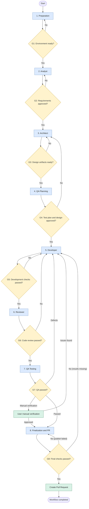

# AgentCraft — Development Workflow

## Overview

The AgentCraft workflow defines a structured process for AI-assisted software development, from initial task preparation to Pull Request creation.

It consists of eight stages:

1. Preparation
2. Analyst
3. Architect
4. QA Planning
5. Developer
6. Reviewer
7. QA Testing
8. Finalization and Pull Request

The workflow is coordinated by an Orchestrator, which manages stage transitions, agent execution, artifact exchange, user approvals, and failure handling.

The user remains responsible for approving requirements, technical decisions, and defined workflow checkpoints.

> **Orchestrator** is the role of the leading Pi agent that coordinates the workflow. Stage agents (Analyst, Architect, QA, Developer, Reviewer) are delegated as subagents via `pi-subagents`. No separate orchestration runtime is created.

---

## Workflow diagram

## Quality Gates

Detailed pass conditions for each gate are in [docs/quality-gates.md](quality-gates.md).

| Gate | What it checks |
|------|----------------|
| G1 | Repository, task, and environment are ready |
| G2 | Requirements and Acceptance Criteria are approved |
| G3 | OpenSpec artifacts are prepared |
| G4 | Test plan and technical solution are agreed |
| G5 | Build and primary Developer checks pass |
| G6 | Independent code review passes |
| G7 | QA passes, or the user confirms manual verification |
| G8 | All mandatory stages are complete, PR data is ready |

> **Note on G3 and G4.** G3 means the Architect's artifacts are ready, not final user approval. Final approval of the whole package happens at G4, after QA Planning.
>
> **Note on G8.** G8 does not re-run testing: it verifies that confirmed results from previous stages exist. On failure the return path depends on the cause: missing results → the failed stage; publication failure → retry Finalization; permission/config → user decision. See [docs/quality-gates.md](quality-gates.md).

---

## 1. Preparation

**Goal:** Prepare the task and working environment.

The Orchestrator:

- Receives the selected task and target repository.
- Retrieves task details and repository context.
- Checks repository availability and existing workflow conflicts.
- Prepares the working environment and a dedicated branch.
- Initializes the workflow and stores the original task information.

**Output:**
- Initialized workflow.
- Task context.
- Prepared repository and working branch.

**Quality Gate:**

The repository is accessible, the task context is available, and the working environment is ready.

---

## 2. Analyst

**Goal:** Understand the task and establish agreed requirements.

The Analyst:

- Investigates the original task and relevant project documentation.
- Explores the codebase to understand the existing behavior.
- Identifies missing information and ambiguities.
- Formulates clarification questions when necessary.
- Produces requirements and acceptance criteria.

The Orchestrator forwards clarification questions to the user and returns answers to the Analyst.

This interaction may repeat until the requirements are sufficiently clear.

The user reviews and approves the resulting requirements.

**Output:**
- Requirements document.
- Acceptance criteria.
- Recorded clarification decisions.

**Quality Gate:**

Requirements are complete enough for technical design and explicitly approved by the user.

---

## 3. Architect

**Goal:** Design the technical solution.

The Architect:

- Studies the existing architecture and relevant implementation.
- Analyzes the approved requirements.
- Identifies affected modules and components.
- Develops the proposed technical solution.
- Prepares OpenSpec artifacts:
  - Proposal.
  - Specs.
  - Design.
  - Tasks.

The Architect must follow existing project conventions and avoid silently changing approved requirements.

**Output:**
- OpenSpec Proposal.
- Updated or new Specs.
- Design document.
- Implementation Tasks.

**Quality Gate:**

The technical solution is documented, consistent with the approved requirements, and ready for independent QA assessment.

> **Important:** G3 confirms artifact readiness, not final approval. Final approval of the package happens at G4.

---

## 4. QA Planning

**Goal:** Independently evaluate the proposed solution and prepare a verification plan before implementation.

The QA Agent receives:
- Approved requirements.
- Acceptance criteria.
- OpenSpec Proposal.
- Specs.
- Design.
- Tasks.

The QA Agent:

- Evaluates whether the solution is testable.
- Identifies missing acceptance criteria.
- Reviews functional and technical risks.
- Identifies negative and boundary scenarios.
- Defines appropriate testing levels.
- Prepares test scenarios and verification criteria.
- Challenges design decisions where they introduce testing or reliability risks.

If problems are identified, the Orchestrator sends the findings to the user.

The user decides whether to:
- Request changes from the Architect.
- Accept the identified risk.
- Request additional clarification.

When the Architect updates the solution, QA Planning is repeated against the updated artifacts.

The user approves the final documentation package before implementation.

**Output:**
- Test plan (scope, levels, scenarios, acceptance mapping, environment, risks, entry/exit criteria).
- Identified risks and recommendations.
- Review findings.

**Quality Gate:**

The technical documentation and Test plan are consistent, identified risks have been addressed or explicitly accepted, and the user has approved the complete package.

---

## 5. Developer

**Goal:** Implement the approved solution.

The Developer receives:
- Approved requirements.
- OpenSpec artifacts.
- Approved Test plan.
- Repository and implementation context.

The Developer:

- Implements the required changes.
- Follows the approved architecture and project conventions.
- Adds or updates automated tests.
- Runs builds, unit tests, integration tests, and other applicable checks.
- Fixes implementation and verification failures.

The Developer must not silently change approved requirements or architectural decisions.

If the implementation reveals contradictions or missing information, the Developer escalates the issue through the Orchestrator.

If work cannot continue, the workflow is suspended and the user is asked for a decision.

**Output:**
- Implemented changes.
- Updated tests.
- Development verification results.

**Quality Gate:**

Implementation is complete and all required primary development checks pass.

---

## 6. Reviewer

**Goal:** Independently review the implementation.

The Reviewer receives:
- Approved requirements.
- OpenSpec artifacts.
- Test plan.
- Implementation changes.
- Developer verification results.

The Reviewer evaluates:
- Compliance with requirements.
- Compliance with approved architecture.
- Code quality and maintainability.
- Potential defects and edge cases.
- Test quality and coverage.

If issues are found, the Orchestrator returns them to the Developer.

The Developer makes corrections, runs the necessary checks, and submits the changes for another review.

The cycle continues until the review passes or requires escalation to the user.

**Output:**
- Code review report.
- Findings and recommendations.
- Review status.

**Quality Gate:**

The implementation passes independent code review.

Code review does not replace functional QA testing.

---

## 7. QA Testing

**Goal:** Verify the actual implementation against the approved requirements and Test plan.

The QA Agent receives:
- Current implementation.
- Requirements and acceptance criteria.
- Approved Test plan.
- Developer verification results.
- Reviewer report.

The QA Agent attempts to prepare the test environment and run the application.

When successful, it performs the planned checks:
- Functional scenarios.
- API and endpoint verification.
- Positive and negative cases.
- Boundary conditions.
- Integration behavior.
- Acceptance criteria verification.

The QA Agent records actual results and identified defects.

### When automatic verification is not possible

The QA Agent investigates the problem and attempts to resolve environment or execution issues.

If it cannot proceed independently, it prepares reproducible manual verification instructions for the user, including:
- Required dependencies.
- Environment configuration.
- Build and startup instructions.
- API requests and test data.
- Expected results.
- Specific verification points.

The Orchestrator forwards these instructions to the user and waits for the result.

### QA statuses

- `PASSED` — automated QA checks completed successfully.
- `FAILED` — defects were identified and require correction.
- `MANUAL_VERIFICATION_REQUIRED` — user verification is required; QA is not considered passed yet.

When defects are found, the workflow returns to Developer.

Because code changes after review invalidate the previous review of those changes, the updated implementation must pass Reviewer again before QA Testing is repeated.

When manual verification is required, the workflow waits for user confirmation. If the user identifies defects, they are returned to Developer.

**Output:**
- QA report.
- Test execution results.
- Findings (defects and observations) in the shared findings format, if any.
- Manual verification instructions, when required.

**Quality Gate:**

QA must finish with a positive result, either through successful automated verification or successful user-confirmed manual verification.

`MANUAL_VERIFICATION_REQUIRED` is not a successful QA result.

---

## 8. Finalization and Pull Request

**Goal:** Finalize the workflow and publish the changes for review.

The Orchestrator verifies that:
- All required workflow stages are completed.
- Developer checks passed.
- Reviewer approved the implementation.
- QA Testing has a confirmed positive result.

The Orchestrator collects the workflow artifacts:
- Requirements.
- OpenSpec documentation.
- Test plan.
- Developer verification results.
- Reviewer report.
- QA report.

It then:

- Prepares the final workflow report.
- Publishes the working branch.
- Creates a Pull Request against the target branch.
- Includes a summary of changes, related task, and verification results.
- Notifies the user.

The workflow is marked as completed and the working environment is released.

Pull Request merging remains the user's responsibility.

**Output:**
- Final workflow report.
- Published branch.
- Pull Request.
- Completed workflow.

**Quality Gate:**

All required stages have passed, the Pull Request is successfully created, and the user is notified.

> **Important:** G8 does not re-run testing. It verifies that confirmed results from previous stages exist.

---

## General Workflow Rules

### User Approval

User approval is required at defined checkpoints.

No implementation may begin before the requirements, technical solution, and Test plan have been approved.

### Iteration and Recovery

Workflow stages may be repeated when corrections are required.

Changes must be verified again by the appropriate stages.

### Independent Verification

Developer, Reviewer, and QA have separate responsibilities.

Automated and deterministic verification should be preferred wherever practical.

### Traceability

Requirements, technical decisions, implementation changes, and verification results must remain traceable throughout the workflow.

### Failure Handling

When an agent cannot proceed, the Orchestrator must preserve the current workflow state and request user intervention when necessary.

A workflow must not be marked as completed while required stages or approvals remain outstanding.
