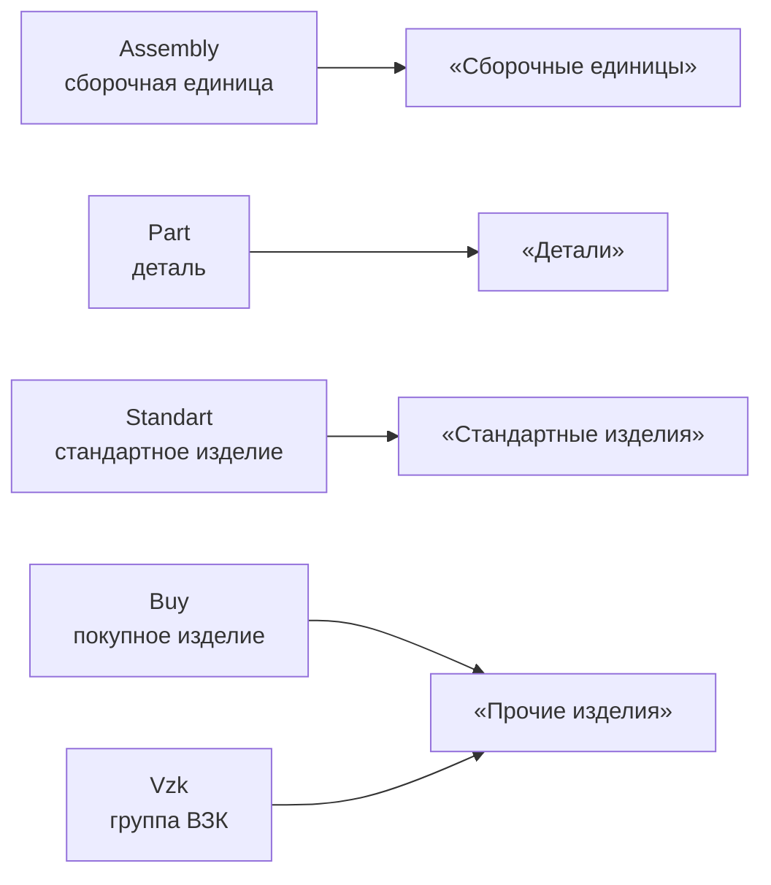
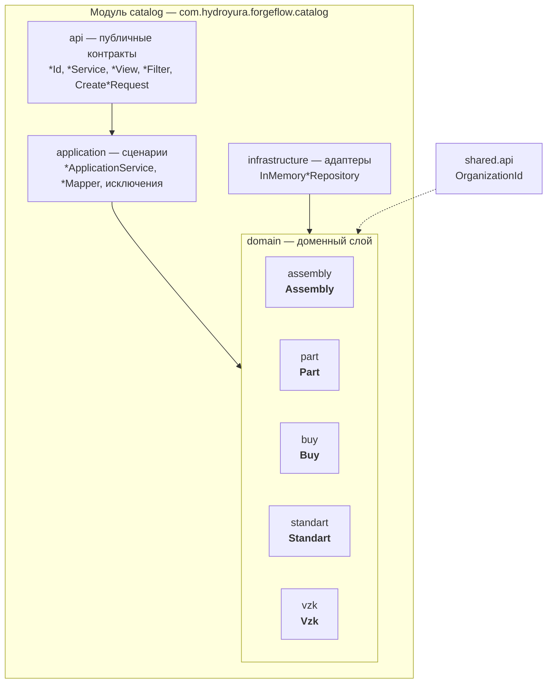

# Саб-домены модуля `catalog`

> **Правило:** перечитывать этот файл перед любой работой над модулем `catalog`.

## Назначение модуля

Модуль `catalog` — каталог изделий ForgeFlow. Хранит номенклатуру, на которую ссылаются
спецификации, технологические процессы и расчёты потребностей производства.

Внутри модуля выделяется **пять саб-доменов** — пять различимых типов номенклатуры.
Каждый саб-домен живёт в отдельном подпакете `domain/<имя>` и имеет собственную доменную
сущность, типизированный идентификатор, порт репозитория и публичные контракты в `api`.

## Саб-домены и разделы спецификации (ЕСКД)

| Саб-домен  | Пакет             | Раздел спецификации (ЕСКД) | Смысл и значимость                                    |
|------------|-------------------|----------------------------|-------------------------------------------------------|
| `Assembly` | `domain/assembly` | Сборочные единицы          | изделие, собираемое из нескольких составных частей    |
| `Part`     | `domain/part`     | Детали                     | изделие собственного изготовления                     |
| `Standart` | `domain/standart` | Стандартные изделия        | изделие, выполненное по ГОСТ (винт ГОСТ …)            |
| `Buy`      | `domain/buy`      | Прочие изделия             | покупное изделие, выбранное из каталога производителя |
| `Vzk`      | `domain/vzk`      | Прочие изделия             | группа взаимозаменяемых комплектующих (ВЗК)           |

Итого: **четыре раздела ЕСКД, пять саб-доменов**. `Buy` и `Vzk` оба относятся к разделу
«Прочие изделия».

### Важные оговорки

- **`Vzk` — расширение ForgeFlow.** В ГОСТ Р 2.106-2019 аналога нет: группа ВЗК не является
  разделом спецификации. В каталоге размещается в «Прочие изделия», но разделом ЕСКД не
  является — это следует понимать при работе с моделью.
- **Остальные разделы ЕСКД не покрываются каталогом** и относятся к другим релизам:
  «Документация», «Комплексы», «Материалы» (модуль `directories`), «Комплекты»,
  «Программные изделия и базы данных».

## Отображение саб-доменов на разделы ЕСКД

## Структура модуля

## Текущее состояние и границы

- Все пять сущностей структурно идентичны («домен-скелет»): идентификатор, номер, наименование,
  принадлежность организации, аудит, мягкое удаление и `rename`.
- Связей между саб-доменами сейчас нет: `Assembly` ещё не ссылается на `Part`, `Buy` и т.д.
  Это появится при развитии модели спецификаций (BOM).
- Различие между саб-доменами — только в типе номенклатуры и разделе ЕСКД, к которому
  относится изделие.
- Саб-домены изолированы по пакетам и межмодульно доступны только через `api`.
